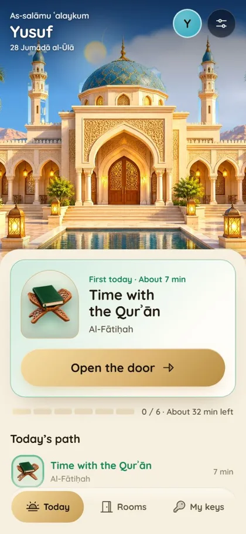
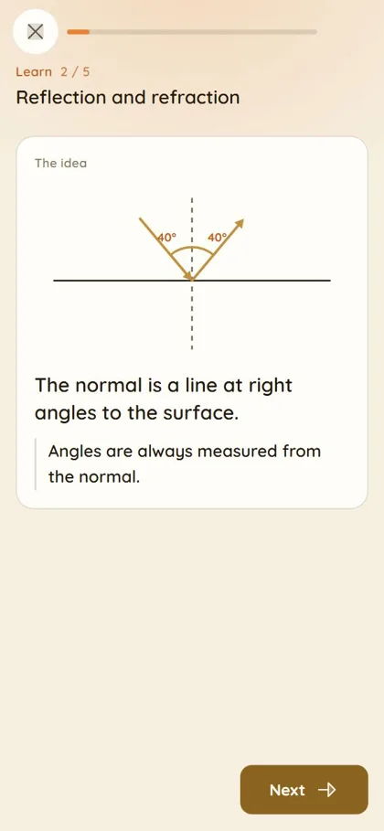
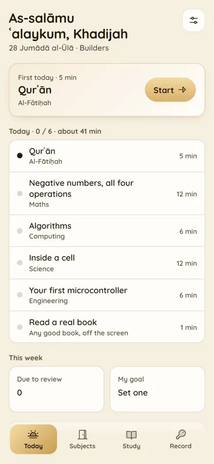
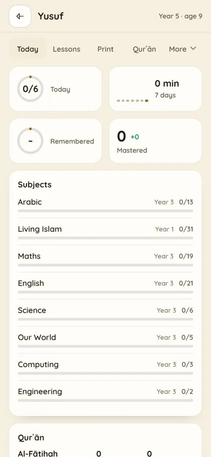

# Miftāḥ · مِفْتَاح

**An Islamic homeschool for children aged 2 to 18, in English and Arabic, that works fully offline on Android and Windows.**

**[Read the illustrated guide](docs/guide/index.html)**: every screen on the phone and the computer, step by step.

Each day a child gets a short, balanced path, and every skill they master becomes a key:
- Qurʾān memorisation;
- Arabic, maths, science and English;
- Living Islam;
- the wider world.

Parents see what each child did, what they remember, and where they are stuck. Nothing needs an account or the internet.

<p>





</p>

## What makes it different

- **Honest learning.** A lesson counts only when the child shows it on their own. Exams give one try and no hints, and a script plays the cheating child on every release to prove guessing doesn't pay.
- **Taught, not just tested.** Maths for Years 5–10 and science for Years 7–10 follow the same pattern: I show you, we do it together, you do it, you explain it. A checker computes every worked line and balances every chemical equation on every build.
- **Memory that lasts.** Mastered skills come back for review just as they start to fade.
- **Religious text from verified sources only.** The Qurʾān is byte-identical to Tanzil and is never gamified. See [CONTENT.md](CONTENT.md).
- **Private by design.**
  - Learning data stays on the phone. Families move it between devices by sending a file, with no server.
  - Homeschool groups share a picture card or a challenge file through WhatsApp or Telegram.

## Build

**You need:**
- Node 20 or newer;
- Python 3.8 or newer;
- JDK 17;
- the Android SDK with build-tools 36.0.0 and platform android-36. Set `ANDROID_HOME` to the SDK folder.

```bash
npm ci            # once: installs esbuild and jsdom at the versions in package-lock.json
npm test          # the offline checks (about two minutes)
./build.sh        # tests, bundle, then a signed dist/Miftah.apk
FINAL=1 ./build.sh   # also dist/Miftah.aab for the Play Store and a one-file HTML build
```

The version number lives in [`version.txt`](version.txt). Raise `code` on every release that leaves your machine.

### Signing

The signing key is **never** kept in this repository. By default `build.sh` looks in `~/.keys/miftah/` for `miftah-release.jks` and `keystore.properties`.
- **Different folder:** point `MIFTAH_KEYS` at it.
- **Password from the environment:** set `MIFTAH_KS_PASS` instead of keeping `keystore.properties`.
- **Your own fork:** run once with `MIFTAH_NEW_KEY=1` to create a new key. That is a different app identity, so it can't update the official app.

Back up the key offline. An app on the Play Store can only ever be updated with the same key.

### Windows

On Windows 10 or 11, with Python 3.8+ and Pillow:

```bash
python -I tools/build_windows.py      # bundles web/ and compiles dist/Miftah.exe with the C# compiler built into Windows
```

The first run fetches the WebView2 SDK from nuget.org into `tools/.bin/`. No Visual Studio or .NET SDK is needed. CI builds the same file on every push.

### The guide

```bash
python -I tools/build_guide.py        # docs/guide/index.html from the screenshots in build/guide2 (see tools/guide-shots.js)
```

### Try it in a browser

Serve the `web/` folder with any static server and open it at a phone-sized window, for example `npx serve web`. The browser version uses the same code. Android-only features fall back gracefully: recording, notifications, sharing, the home-screen widget.

## Tests

| Command | What it proves |
|---|---|
| `node tools/test.js` | 7,000+ integrity checks: Arabic identical to Tanzil, every recording exists, hadith grades present, wording rules |
| `node tools/smoke.js` | The app's behaviour in jsdom in both languages: evidence rules, memorisation, parent area, saving |
| `node tools/teach-check.js` | Every taught maths and science lesson: each worked line computed, each chemical equation balanced, Arabic present |
| `node tools/strings.js` | Every interface string has Arabic |
| `node tools/cdp.js tools/teach-screens.js build/e2e` | Every step of every taught lesson drawn in both languages (needs a local server on port 5191 and Microsoft Edge or Chrome) |
| `node tools/cdp.js tools/e2e-honesty.js build/e2e` | A cheating child can't pass an exam or master lessons by tapping |
| `node tools/bridge-check.js` | Every bridge method the Android app has also exists in the Windows app |
| `node tools/cdp.js tools/ink-test.js build/ink` | A sheet done on screen: sent, written, finished, marked, joined between devices |
| `node tools/link-test.js <code>` | Pairing and sync with a running Windows app: wrong codes and foreign keys refused, files and records exchanged |

## Where things live

See [docs/ARCHITECTURE.md](docs/ARCHITECTURE.md) for the full map. In short:

| Path | What |
|---|---|
| `web/js/core` | Start-up, router, saving, the learning engine (`engine.js`), day planning (`flow.js`), sharing between devices (`sync.js`) |
| `web/js/lesson` | The lesson player, the teaching engine (`teach.js`), diagrams (`dia.js`, `dia-sci.js`) |
| `web/js/instruments` | Each kind of activity: typing a number, choosing, tracing, sorting, the clock and so on |
| `web/js/curriculum` | The lessons. Taught maths is in `cur-tm-y*.js`, taught science in `cur-ts-y*.js` |
| `web/js/views` | Screens for children, teens and parents; homeschool groups (`v-group.js`) |
| `web/js/data` | Generated data. **Never edit by hand**: `tools/build_content.py` makes it |
| `android/` | The Android shell: a locked-down WebView, sharing, notifications, the widget, pairing with the computer |
| `windows/` | The Windows shell: WebView2, files and backups, PDF, the tray, pairing with the phone |
| `docs/guide/` | The illustrated user guide |
| `tools/` | Build, content generators and checks |
| `docs/` | Design notes, the curriculum map, audits and the review with the roadmap |

## Contributing

See [CONTRIBUTING.md](CONTRIBUTING.md). The most valuable contributions right now:
- taught lessons for subjects and years that don't have them yet;
- tablet and landscape layouts;
- native Arabic review of the interface and lessons.

The roadmap is the checklist at the end of [docs/REVIEW-2026-11.md](docs/REVIEW-2026-11.md).

## Licence

The code is MIT licensed: see [LICENSE](LICENSE). Content comes from the sources listed in [CONTENT.md](CONTENT.md), each on its own terms.
