<div align="center">

# Miftāḥ · مِفْتَاح

**An Islamic homeschool for children aged 2 to 18, in English and Arabic.**<br>
On Android and Windows. Fully offline. No account. Free and open source.

[](https://github.com/Bashyr18/miftah-app/releases/latest)
[](https://bashyr18.github.io/miftah-app/guide/#download)
[](https://github.com/Bashyr18/miftah-app/actions/workflows/check.yml)
[](LICENSE)

[](https://github.com/Bashyr18/miftah-app/releases/latest/download/Miftah.apk)
[](https://github.com/Bashyr18/miftah-app/releases/latest/download/Miftah-Setup.exe)
[](https://bashyr18.github.io/miftah-app/guide/)
[](https://www.linkedin.com/in/bashirbadmus/)

[**Download**](#download) · [**Watch the demo**](#watch-the-demo) · [**The guide**](#the-illustrated-guide) · [**How to use it**](#how-to-use-it) · [**Build it yourself**](#build-it-yourself) · [**The maker**](#the-maker)

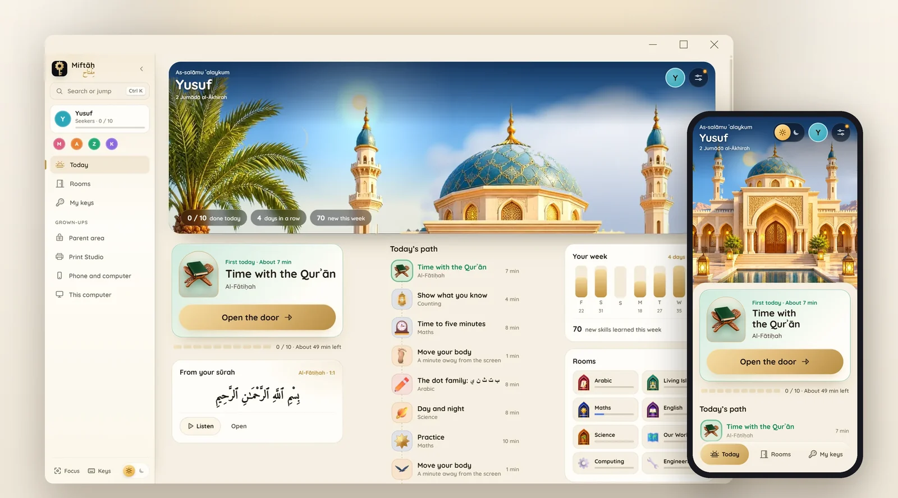

</div>

## Contents

- [What it is](#what-it-is)
- [Download](#download) · [Installing safely](#installing-safely) · [Updates](#updates)
- [Watch the demo](#watch-the-demo)
- [The illustrated guide](#the-illustrated-guide)
- [A look inside](#a-look-inside)
- [How to use it](#how-to-use-it)
- [Sources and privacy](#sources-and-privacy)
- [Build it yourself](#build-it-yourself) · [Tests](#tests) · [Where things live](#where-things-live) · [Contributing](#contributing)
- [The maker](#the-maker) · [Licence](#licence)

## What it is

Each day a child gets a short, balanced path: Qurʾān first, then Arabic, Living Islam, maths, English, science and the wider world, with movement breaks and things to do away from the screen. Every skill they master is kept, and checked again later so it is not forgotten. Parents see what each child did, what they remember and where they are stuck.

- **Honest learning.** A lesson counts only when the child shows it on their own. Guessing never pays.
- **Taught, not just tested.** I show you, we do it together, you do it, you explain it.
- **Religious text from verified sources only.** The Qurʾān is byte for byte from Tanzil, never clipped, and never turned into a game.
- **Private.** Learning data stays on your devices. Nothing needs an account or the internet.
- **Paper that fits a hand.** Sheets made fresh each day, with real answer boxes and squared working space, printed or done on screen and marked by a grown-up.

## Download

| | |
|---|---|
| **Android** 8 or newer | [**Download `Miftah.apk`**](https://github.com/Bashyr18/miftah-app/releases/latest/download/Miftah.apk), open it on the phone and allow the install. |
| **Windows** 10 or 11 | [**Download `Miftah-Setup.exe`**](https://github.com/Bashyr18/miftah-app/releases/latest/download/Miftah-Setup.exe) and open it. It installs Miftāḥ like any Windows program: its own folder, the Start menu, a desktop shortcut if you want one, and an entry in **Settings › Apps** to remove it. No administrator needed. If Windows says the publisher is unknown, choose **More info › Run anyway**. |

Both read and write the same family record, so a family can use the phone and the computer side by side. Every file, with its checksum, is on the [releases page](https://github.com/Bashyr18/miftah-app/releases/latest).

### Installing safely

Android and Windows ask about any app from outside Google Play or the Microsoft Store, simply because they have not met it yet. Miftāḥ is open source, every update is signed with the same key, and every file has a published SHA-256 checksum.

<table>
<tr>
<td width="33%">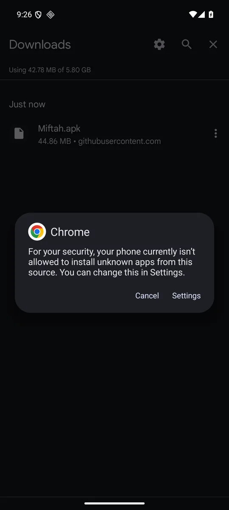</td>
<td width="33%">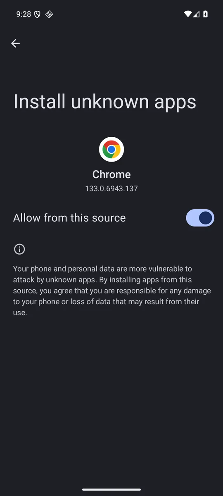</td>
<td width="33%">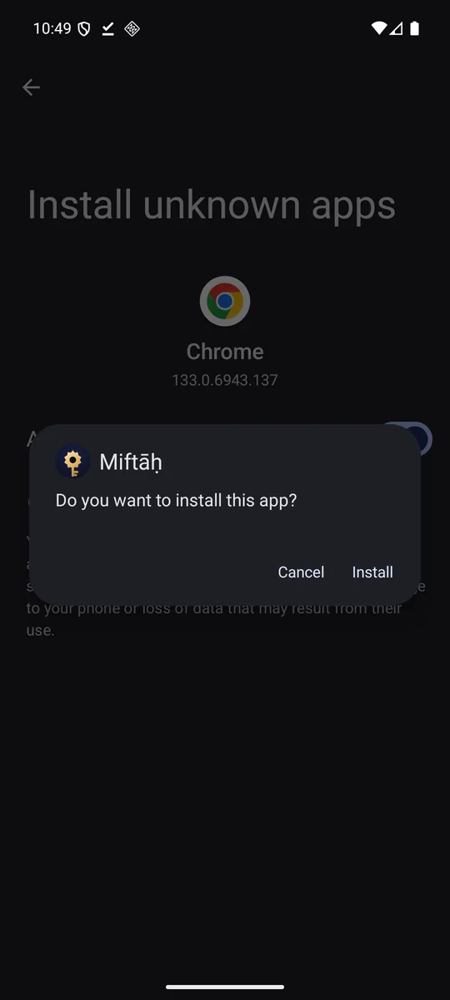</td>
</tr>
<tr>
<td><b>1 · Your phone asks first</b><br>Tap <b>Settings</b>.</td>
<td><b>2 · Allow from this source</b><br>Turn it on, then go back.</td>
<td><b>3 · Install</b><br>If Google Play Protect asks, tap <b>Scan app</b>; it finds nothing.</td>
</tr>
</table>

On Windows, if it says **Windows protected your PC**, choose **More info › Run anyway**. Every step, with real screens: [the guide's install section](https://bashyr18.github.io/miftah-app/guide/#download).

### Updates

From version 2.1, updates come from inside the app: **Parent area › Settings** on the phone, **This computer** on Windows. Press **Check for updates**, or turn on a weekly check (off by default). Miftāḥ verifies the signed update manifest and SHA-256 checksum before installing; the family's record is never touched.

## Watch the demo

<a href="https://github.com/Bashyr18/miftah-app/releases/latest/download/Miftah-demo.mp4">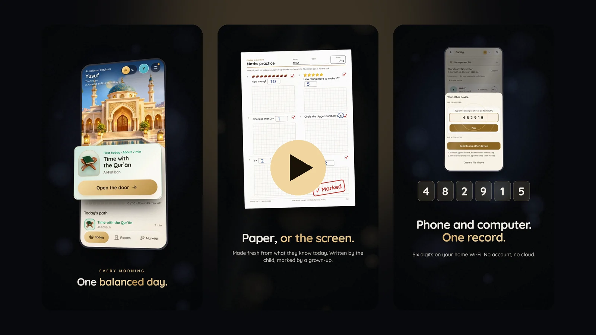</a>

Forty-five seconds, every screen real: the day, the lessons, paper, the parents' view, the computer and the phone together. [Watch it (MP4)](https://github.com/Bashyr18/miftah-app/releases/latest/download/Miftah-demo.mp4).

## The illustrated guide

<a href="https://bashyr18.github.io/miftah-app/guide/">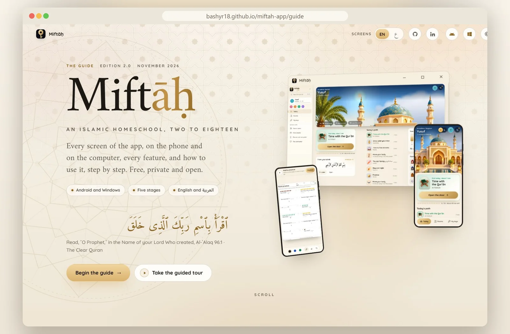</a>

**[Open the guide →](https://bashyr18.github.io/miftah-app/guide/)**

Every screen of the app, on the phone and the computer, with each feature marked and explained step by step.

| | |
|---|---|
| **Twenty spreads** | From the first door to backups, in the order a family meets them. |
| **Guided tours** | Press **Walk me through** on any spread and the guide shows each step in turn. |
| **Day, night and Arabic** | The same pages in the light theme, the dark theme and in العربية, right to left. |
| **Works anywhere** | One page in any browser, on a phone or a computer. |

<a href="https://bashyr18.github.io/miftah-app/guide/">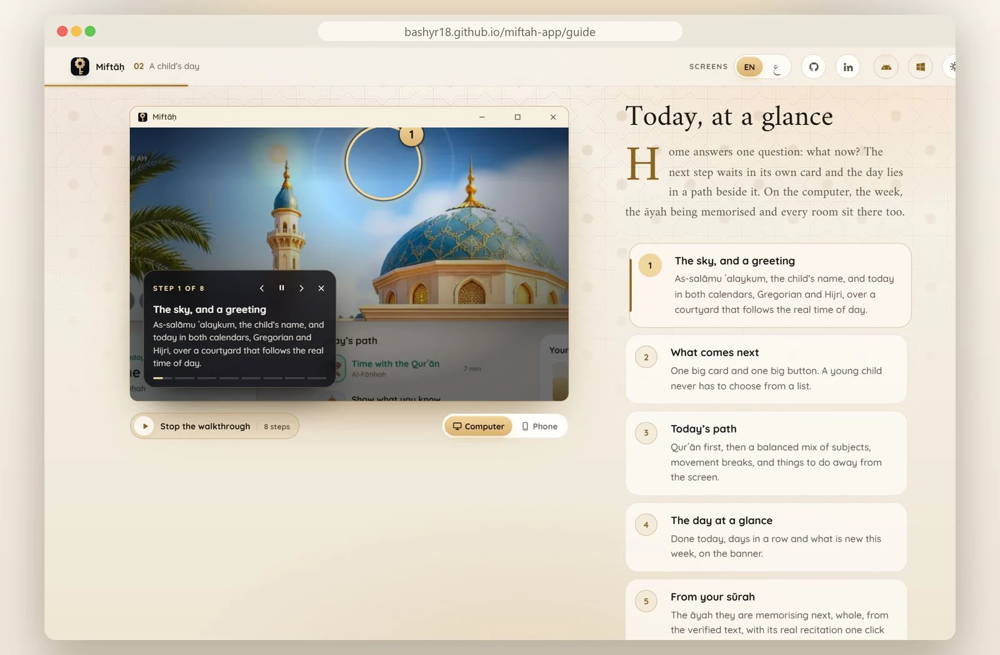</a>

## A look inside

### A child's day

<table>
<tr>
<td width="33%">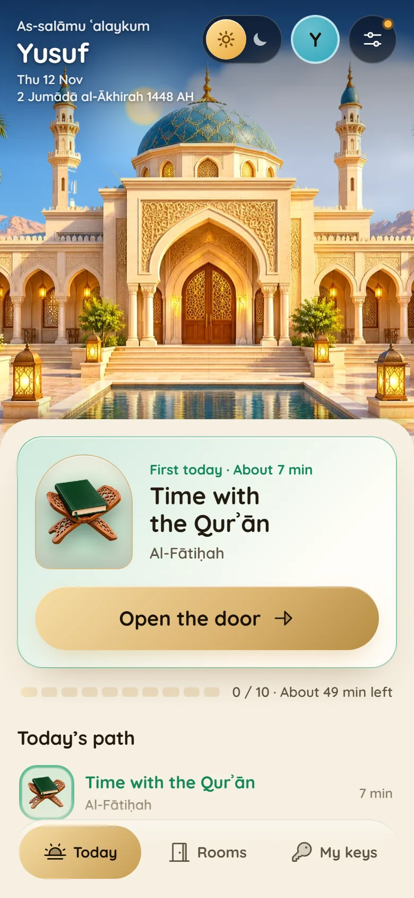</td>
<td width="33%">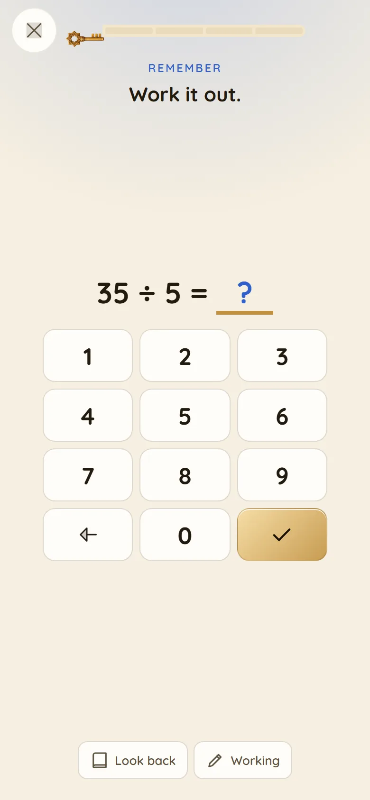</td>
<td width="33%">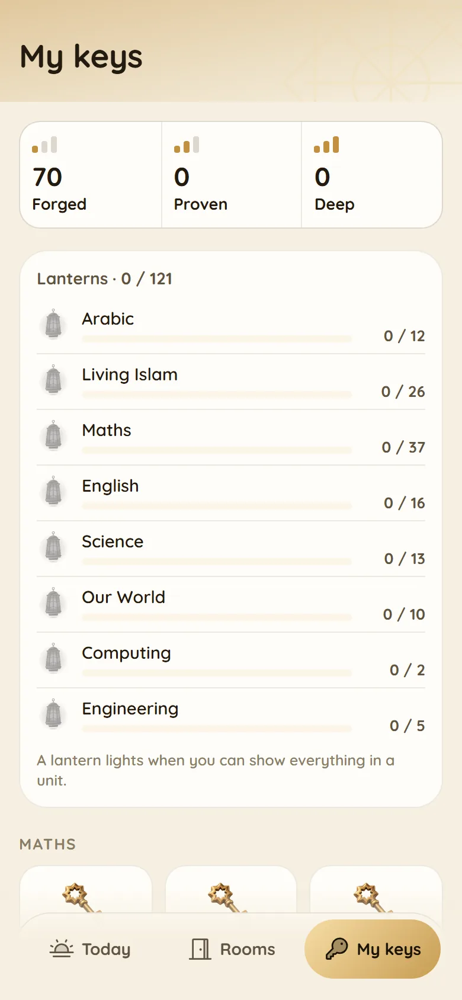</td>
</tr>
<tr>
<td><b>Today</b><br>One big card for what comes next, and the day's path beneath it.</td>
<td><b>A lesson</b><br>A number pad, picture choices or tracing, with help that teaches rather than tells.</td>
<td><b>What stays</b><br>Learned, still right after a break, kept for months: memory shown honestly.</td>
</tr>
</table>

### Every age, one app

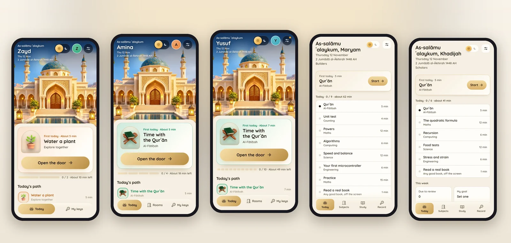

Five stages, from **Little Steps** (2 to 4, played beside a grown-up) to **Scholars** (15 to 18, with exams, papers and their own record). The design, the pace and the voice change with the child.

### For parents

<table>
<tr>
<td width="62%">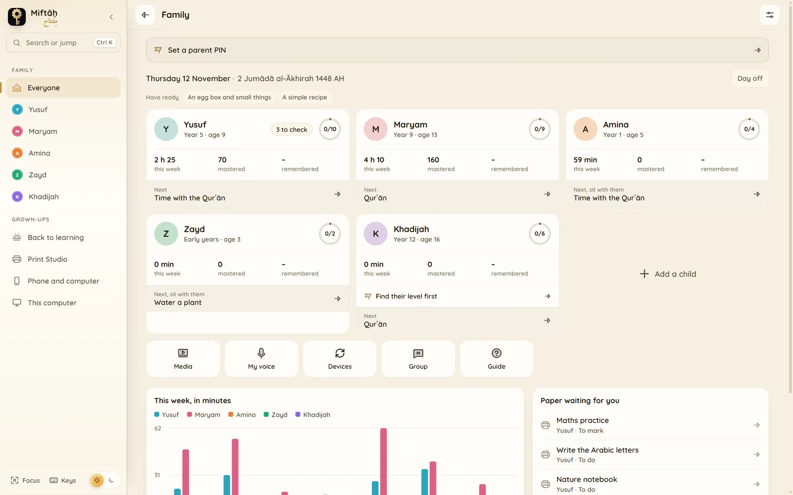</td>
<td width="38%">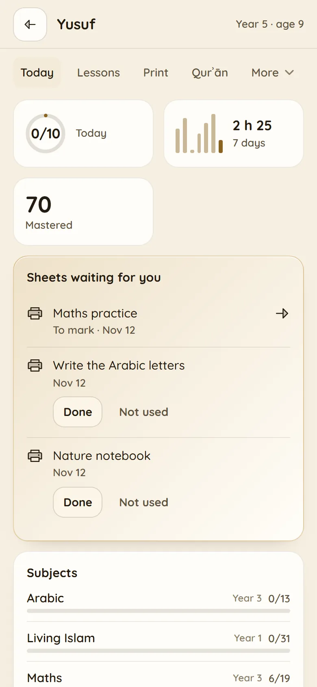</td>
</tr>
<tr>
<td><b>The whole family</b><br>Every child on one page, the week in minutes, and the paper waiting for you.</td>
<td><b>One child, in depth</b><br>Today, lessons, print and Qurʾān, in tabs.</td>
</tr>
</table>

### Paper, or the screen

<table>
<tr>
<td width="38%">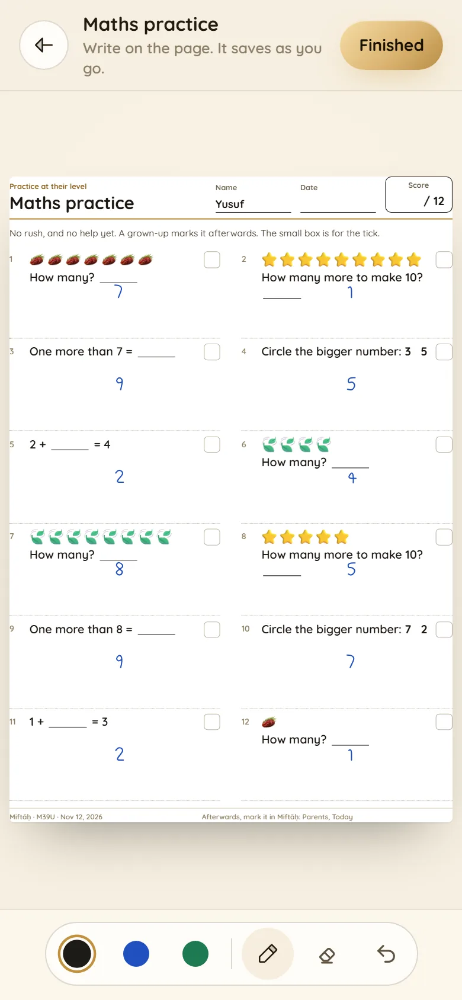</td>
<td width="62%">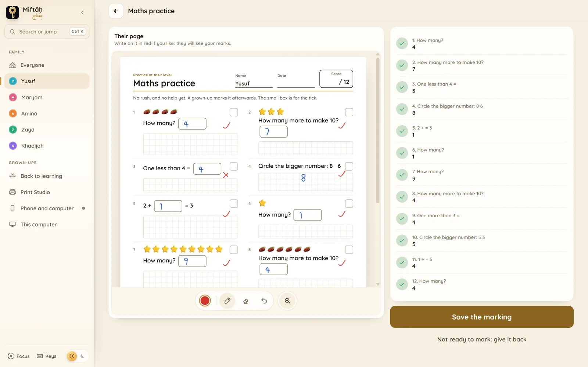</td>
</tr>
<tr>
<td><b>Done on screen</b><br>Any practice or writing sheet can be done on the real page, with a finger, a pen or a mouse.</td>
<td><b>Marked by a grown-up</b><br>Red marks on their page, then question by question. Only this marking counts, exactly as on paper.</td>
</tr>
</table>

Every sheet is made fresh from what the child knows today and fills a true A4 page in English or Arabic. On the computer, **Print Studio** prints several at once or saves them as one PDF.

### On the computer

<table>
<tr>
<td width="50%">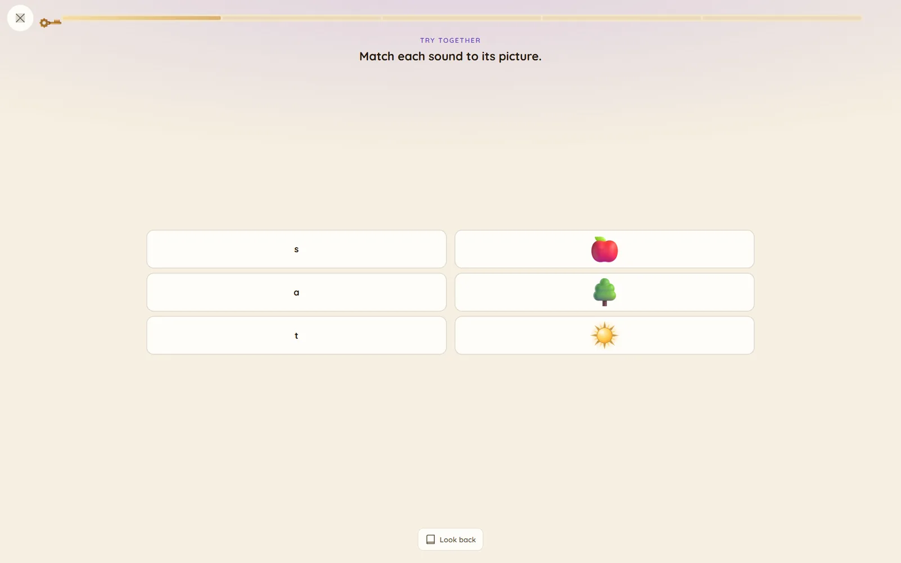</td>
<td width="50%">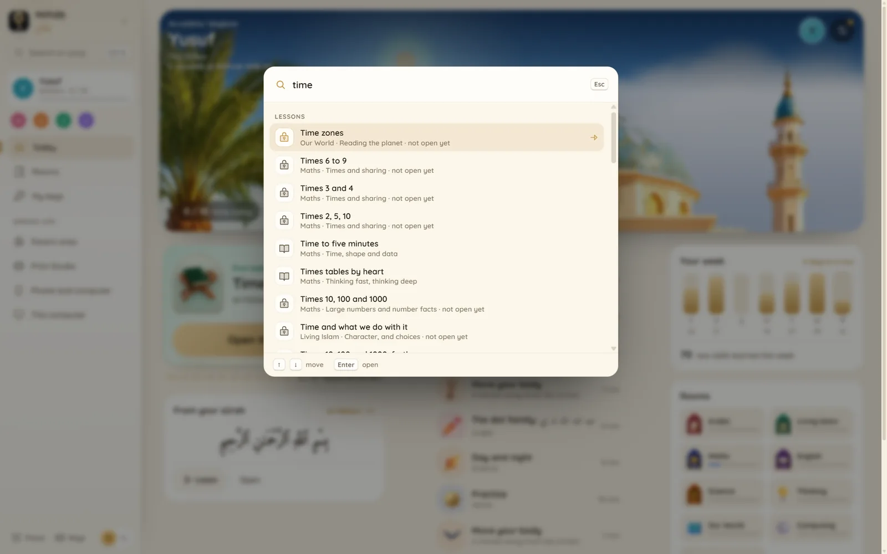</td>
</tr>
<tr>
<td><b>Room to work</b><br>The sum and squared working paper on the left, the answer opposite. Type the answer, press Enter.</td>
<td><b>Go anywhere</b><br>Ctrl K finds any child, subject, lesson or tool.</td>
</tr>
</table>

Also on Windows: thirty days of backups, start with Windows, a daily reminder in the tray, **Focus** (a lesson fills the screen and only a grown-up can leave it), and the size of everything from 70% to 200%.

### Phone and computer, together

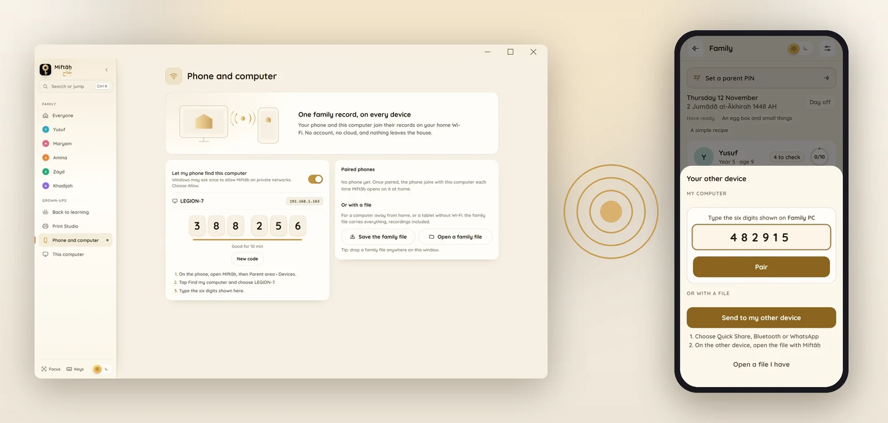

Pair once with the one-time code shown on your computer. After that the phone joins its record with the computer by itself whenever Miftāḥ opens at home, recordings and photos included. Each connection uses fresh authentication and encrypted messages. Upgrade both apps and pair again if you previously used a six-digit code. Learning records stay on your devices.

### By night, and in Arabic

<table>
<tr>
<td width="62%">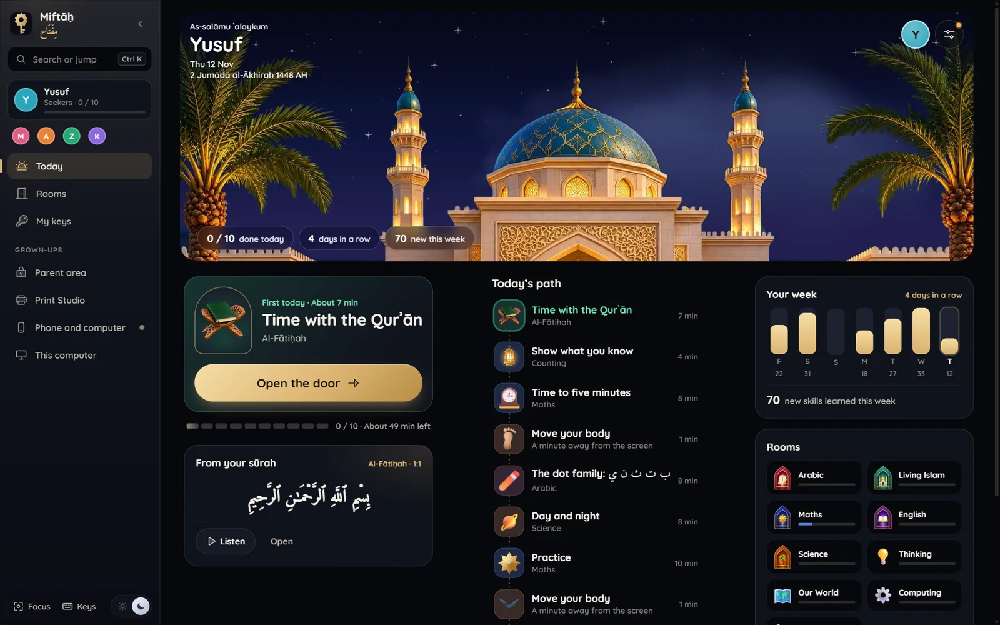</td>
<td width="38%">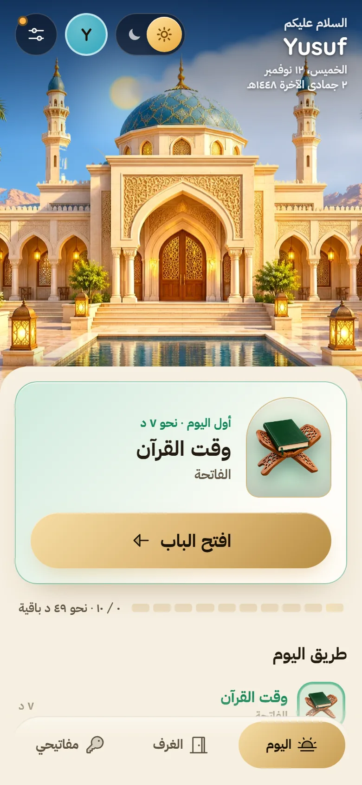</td>
</tr>
</table>

## How to use it

A simple path for the first week. The [illustrated guide](https://bashyr18.github.io/miftah-app/guide/) shows every step on every screen.

1. **Install it** on the phone, the computer, or both ([Download](#download)).
2. **Open the first door.** Choose English or العربية, press **Begin**, and add your first child: a name and an age. The age sets their stage.
3. **Start the day.** Each child taps their name, then **Open the door**. They work through today's path one step at a time.
4. **Open the parent area** with the button at the top right (a small sum keeps young children out, or set a PIN with a recovery code). Here you add brothers and sisters, see each child's day, and change their plan.
5. **Print or send a sheet.** In a child's **Print** tab, choose a sheet and print it, save a PDF, or press **Do it on screen**. When it comes back, mark it from **Today**.
6. **Join your phone and computer.** On the computer open **Phone and computer**, turn it on and press **Pair a phone**. On the phone open **Parent area › Devices › Find my computer** and enter the displayed code. Without Wi-Fi, **Send to my other device** does the same with a file.
7. **Back up.** On the computer, **This computer › Backups** keeps a copy each day. On the phone, a family file is a complete backup too.

## Sources and privacy

- The Qurʾān from Tanzil; its translation from *The Clear Quran* (Dr Mustafa Khattab, used with permission); duʿāʾ from Ḥiṣn al-Muslim. Every source is listed in [CONTENT.md](CONTENT.md), and the build checks the text on every change.
- No adverts, no analytics, no account. The only internet use is a video a grown-up adds, or a recitation fetched once and then kept.

## Build it yourself

**You need:**
- Node 20 or newer;
- Python 3.8 or newer;
- JDK 17;
- the Android SDK with build-tools 36.0.0 and platform android-36. Set `ANDROID_HOME` to the SDK folder.

```bash
npm ci            # once: installs esbuild and jsdom at the versions in package-lock.json
npm test          # the offline checks (about two minutes)
./build.sh        # tests, bundle, then a signed dist/Miftah.apk
FINAL=1 ./build.sh   # also dist/Miftah.aab for the Play Store and a one-file HTML build
```

The version number lives in [`version.txt`](version.txt). Raise `code` on every release that leaves your machine.

### Signing

The signing key is **never** kept in this repository. By default `build.sh` looks in `~/.keys/miftah/` for `miftah-release.jks` and `keystore.properties`.
- **Different folder:** point `MIFTAH_KEYS` at it.
- **Password from the environment:** set `MIFTAH_KS_PASS` instead of keeping `keystore.properties`.
- **Your own fork:** run once with `MIFTAH_NEW_KEY=1` to create a new key. That is a different app identity, so it can't update the official app.

Back up the key offline. An app on the Play Store can only ever be updated with the same key.

### In-app update manifests

Use a separate P-256 key for update metadata. Keep the private PEM file outside the repository and back it up offline. Set `MIFTAH_UPDATE_PUBLIC_KEY` to the base64 of the key's DER SubjectPublicKeyInfo before building Android and Windows. The Windows installer embeds the same app binary. Local builds without a public key can be updated by installing a new build manually.

For example, OpenSSL can export the public value from an existing P-256 signing key:

```bash
export MIFTAH_UPDATE_PUBLIC_KEY="$(openssl pkey -in "$MIFTAH_UPDATE_SIGNING_KEY" -pubout -outform DER | openssl base64 -A)"
```

After building both release packages, run `python -I tools/release_meta.py` with `MIFTAH_UPDATE_SIGNING_KEY` pointing to the private PEM file and Python's `cryptography` package installed. The tool checks both packages' public keys before signing `dist/version.json`. Upload that manifest with the matching release assets. Keep using the same manifest signing key for updates to deployed builds.

### Windows

On Windows 10 or 11, with [Rust](https://rustup.rs) (the stable MSVC toolchain), Python 3.8+ and Pillow:

```bash
python -I tools/build_windows.py      # bundles web/, then builds dist/Miftah.exe and dist/Miftah-Setup.exe
```

The program is Rust (`windows/`): the first run fetches its crates from crates.io, pinned by `windows/Cargo.lock`. WebView2's loader is linked in, so each program is one file. CI builds the same files on every push.

### The guide

```bash
python -I tools/build_guide.py        # the guide page; new screenshots come from tools/guide-shots.js
```

### The README pictures

```bash
node tools/cdp.js tools/guide-preview.js build/preview   # pictures of the guide itself (serve docs/guide on port 5192 first)
python -I tools/readme_images.py      # docs/screens/*.webp, composed from the guide's screenshots
```

### Download counts

Once a day, `.github/workflows/downloads.yml` saves GitHub's own release download counts to the `stats` branch (`tools/download_stats.py`). The guide shows the total, Android against Windows, each version and downloads per day, from those snapshots and the live counts. Run it by hand from **Actions › download counts › Run workflow**.

### Try it in a browser

Serve the `web/` folder with any static server and open it at a phone-sized window, for example `npx serve web`. The browser version uses the same code. Android-only features fall back gracefully: recording, notifications, sharing, the home-screen widget.

## Tests

| Command | What it proves |
|---|---|
| `node tools/test.js` | 7,000+ integrity checks: Arabic identical to Tanzil, every recording exists, hadith grades present, wording rules |
| `node tools/smoke.js` | The app's behaviour in jsdom in both languages: evidence rules, memorisation, parent area, saving |
| `node tools/teach-check.js` | Every taught maths and science lesson: each worked line computed, each chemical equation balanced, Arabic present |
| `node tools/strings.js` | Every interface string has Arabic |
| `node tools/cdp.js tools/teach-screens.js build/e2e` | Every step of every taught lesson drawn in both languages (needs a local server on port 5191 and Microsoft Edge or Chrome) |
| `node tools/cdp.js tools/e2e-honesty.js build/e2e` | A cheating child can't pass an exam or master lessons by tapping |
| `node tools/bridge-check.js` | Every bridge method the Android app has also exists in the Windows app |
| `node tools/cdp.js tools/ink-test.js build/ink` | A sheet done on screen: sent, written, finished, marked, joined between devices |
| `node tools/cdp.js tools/sheet-check.js build/sheets` | Every printable for three ages in both languages, laid out at true A4 size and measured: nothing off the paper, no question running into the next, working space never squeezed, answer boxes big enough to write in |
| `node tools/link-test.js <code>` | Pairing and sync with a running Windows app: wrong codes and foreign keys refused, files and records exchanged |

## Where things live

See [docs/ARCHITECTURE.md](docs/ARCHITECTURE.md) for the full map. In short:

| Path | What |
|---|---|
| `web/js/core` | Start-up, router, saving, the learning engine (`engine.js`), day planning (`flow.js`), sharing between devices (`sync.js`) |
| `web/js/lesson` | The lesson player, the teaching engine (`teach.js`), diagrams (`dia.js`, `dia-sci.js`) |
| `web/js/instruments` | Each kind of activity: typing a number, choosing, tracing, sorting, the clock and so on |
| `web/js/curriculum` | The lessons. Taught maths is in `cur-tm-y*.js`, taught science in `cur-ts-y*.js` |
| `web/js/views` | Screens for children, teens and parents; homeschool groups (`v-group.js`) |
| `web/js/data` | Generated data. **Never edit by hand**: `tools/build_content.py` makes it |
| `android/` | The Android shell: a locked-down WebView, sharing, notifications, the widget, pairing with the computer |
| `windows/` | The Windows shell: WebView2, files and backups, PDF, the tray, pairing with the phone |
| `docs/guide/` | The illustrated user guide |
| `tools/` | Build, content generators and checks |
| `docs/` | Design notes, the curriculum map, audits and the review with the roadmap |

## Contributing

See [CONTRIBUTING.md](CONTRIBUTING.md). The most valuable contributions right now:
- taught lessons for subjects and years that don't have them yet;
- tablet and landscape layouts;
- native Arabic review of the interface and lessons.

The roadmap is the checklist at the end of [docs/REVIEW-2026-11.md](docs/REVIEW-2026-11.md).

## The maker

Made by **Bashir Badmus**. Questions, ideas and corrections are welcome on [LinkedIn](https://www.linkedin.com/in/bashirbadmus/) or as a [GitHub issue](https://github.com/Bashyr18/miftah-app/issues).

## Licence

The code is MIT licensed: see [LICENSE](LICENSE). Content comes from the sources listed in [CONTENT.md](CONTENT.md), each on its own terms.
